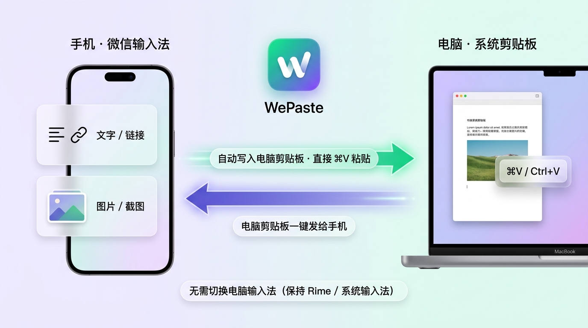

# WePaste

**无需切换电脑输入法，直接双向同步手机「微信输入法」与电脑（macOS / Windows）系统剪贴板。**

  

手机上用微信输入法很顺手，但在电脑（Mac / Windows）上往往主力使用系统自带输入法、Rime 或搜狗输入法。官方微信输入法桌面端要求切换到它的输入法状态下才能完整使用跨设备剪贴板。

**WePaste** 是一个常驻菜单栏（macOS Menu Bar）/ 系统托盘（Windows System Tray）的轻量小工具，让你**保持电脑原有的打字输入法不变**，同时打通手机微信输入法的跨设备剪贴板：
- **手机复制 ──▶ 电脑直接 `⌘V` / `Ctrl+V`**：在手机上复制任意**文字、网页链接、手机截图或相册图片**，WePaste 后台自动接收并直接写入电脑系统剪贴板。
- **电脑复制 ──▶ 一键发给手机**：在电脑上复制文字或截图后，点击面板或菜单栏「把电脑剪贴板发给手机」，手机微信输入法候选栏即可直接粘贴。
- **Arc Split-Deck 流光双太空舱界面**：内置「☀️ 亮色版」与「🌙 暗色版」双主题界面，支持窗口任意空白区域拖拽、主显示手机切换、开机自启与自动检查更新。

---

## 怎么使用

1. **下载并启动 WePaste**：应用启动后会常驻在电脑顶部菜单栏（macOS）或右下角系统托盘（Windows）。
2. **输入 6 位配对码**：
   - 打开手机 **「微信输入法」App →「跨设备复制粘贴」**；
   - 在电脑 WePaste 面板中输入手机上显示的 **6 位数字配对码**，点击 **「确认配对」**；
   - 在手机弹出的连接确认框中点击 **「连接」**。
3. **日常无感同步**：
   - **手机 → 电脑**：保持默认开启的「⚡ 实时同步 ON」，手机上一复制文字或截图，电脑端无需任何操作即可直接按 `⌘V`（macOS）或 `Ctrl+V`（Windows）粘贴。
   - **电脑 → 手机**：在电脑上复制内容后，点击 WePaste 面板下半区的 **「🚀 发送上面这条电脑剪贴板到手机」**（或菜单栏右键菜单中的「把电脑剪贴板发给手机」）。

  

---

## 本地开发与构建

关于项目目录结构、本地编译调试、macOS 签名以及 GitHub Actions 自动发版配置，请参阅 **[本地开发与构建指南 (`dev.md`)](dev.md)**。

---

## 致谢（Credits）

WePaste 的诞生离不开以下优秀开源项目的探索与基础支持，特此致谢：

- **[mkdir700/wx-ime-sdk](https://github.com/mkdir700/wx-ime-sdk)**（作者：[@mkdir700](https://github.com/mkdir700)，`MIT OR Apache-2.0`）：微信输入法跨设备通信协议（`wx-ime-protocol` 与 `wx-ime-sdk`）的完整逆向分析与 Rust 实现，涵盖了 ECDH P-256 密钥协商、AES-GCM 报文加解密、6 位配对码握手以及腾讯云 COS 大文件/图片分片传输，是本项目最核心的协议基石。
- **[mkdir700/wetype-clipboard-mcp](https://github.com/mkdir700/wetype-clipboard-mcp)**（作者：[@mkdir700](https://github.com/mkdir700)）：基于微信输入法跨设备剪贴板协议实现的 MCP 工具服务，为本项目的状态机设计与剪贴板收发工作流提供了重要参考。
- **[tauri-apps/tauri](https://github.com/tauri-apps/tauri)**（`Apache-2.0 OR MIT`）：提供跨平台（macOS / Windows）轻量级桌面窗口、系统托盘（Tray Icon）、开机自启（`tauri-plugin-autostart`）、单实例守护（`tauri-plugin-single-instance`）与自动升级（`tauri-plugin-updater`）能力。
- **[1Password/arboard](https://github.com/1Password/arboard)**（`MIT OR Apache-2.0`）：1Password 开源的跨平台系统剪贴板读写库，用于将手机同步过来的文字与 RGBA 图像直接写入 macOS 与 Windows 系统剪贴板。
- **[image-rs/image](https://github.com/image-rs/image)**（`MIT OR Apache-2.0`）：用于在系统剪贴板原始像素与 PNG 图像格式之间进行高效编解码。
